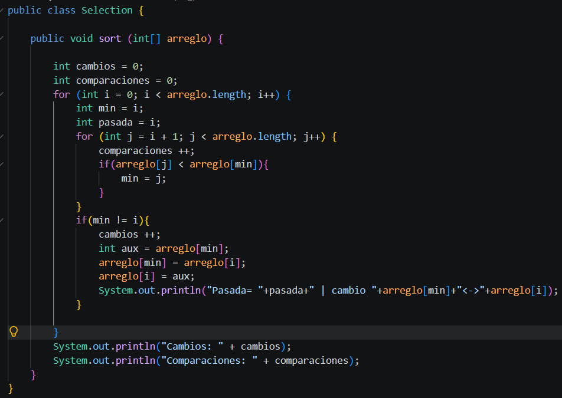
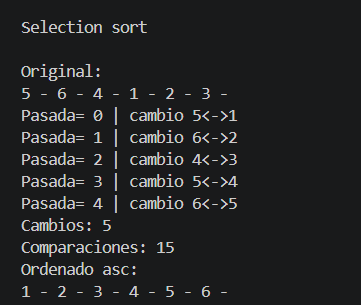

Selection Sort .-

En este método utilizamos el ordenamiento por selección, que busca el número menor en cada pasada del arreglo y colocarlo en la posición inicial. Para ello, usamos la variable i, que indica dónde se colocará el número menor. Mediante una comparación, se encuentra el menor y se intercambia de posición usando una variable temporal o auxiliar, hasta que todos los números estén ordenados de menor a mayor, es decir de forma ascendente. 

Resultado de código: 

