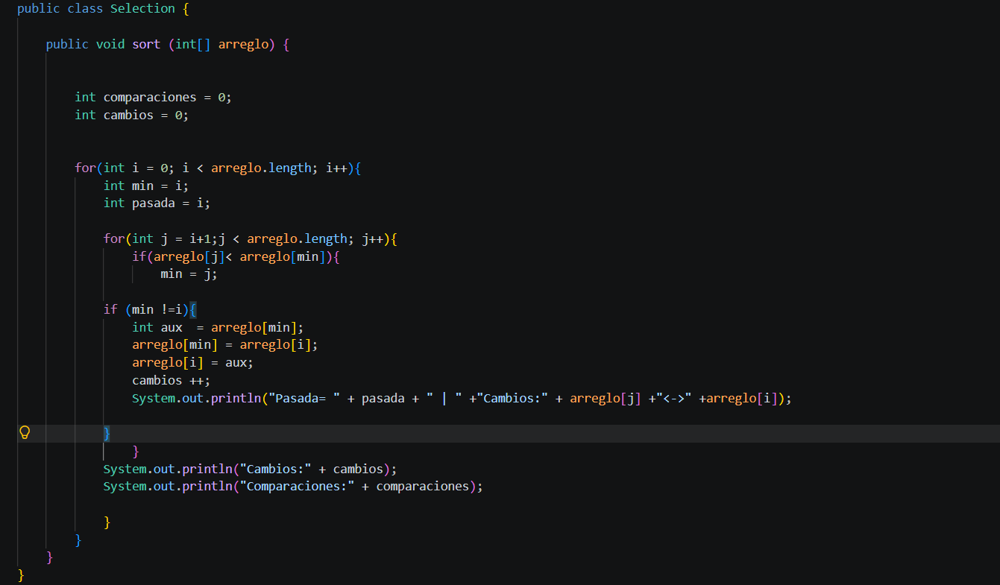
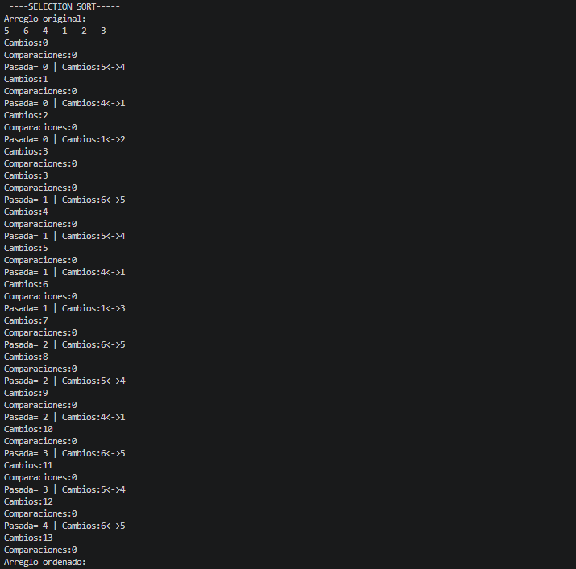

Selection Sort .-

Pasada recorre con el valor de i
Se debe tomar los valores de la posiciones de los intercambios para formar el arreglo correcto, es decir, de forma ordenada. 
Resultado de código: 

