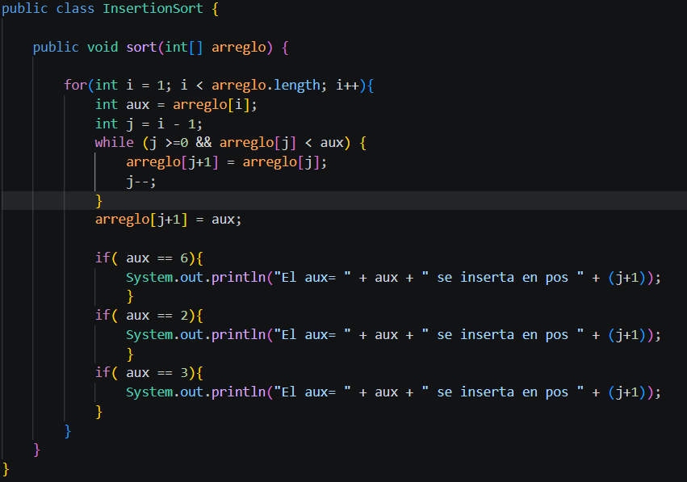
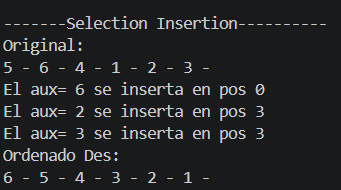

Método Insertion.-

Este algoritmo ordena de forma descendente empezando desde la posición 1. Va comparando el número actual de esa posición con el anterior y, mediante la variable aux, guarda temporalmente el número que sale del arreglo para encajarlo en su espacio vacío, determinando siempre la posición en la que se va a intercambiar, es decir, que según avance de posición el arreglo, el aux va a cambiar de valor. Además se utilizaron comparación de aux, simplemente para imprimir en consola los numeros deseados. 

Resultado en consola: 

